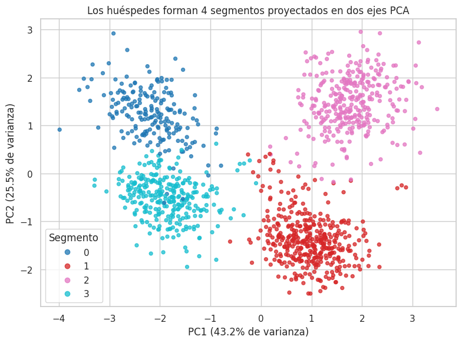

# Equipo 5 Green · Ficha de segmentos — «Conocer al huésped»

Fecha : 16 \- 17.11.2026&nbsp;

Scrum master Cristina, Tecnico Francis&nbsp;

**Cliente:** TurisData · **Integrantes:** Cristina, Miguel, Fran, Andrii y Anzhela.

## Decisión de segmentación

- **k elegido:** 4  
- **Silueta:** 0,431  
- **Justificación técnica y de negocio:** Elegimos k \= 4 porque la silueta es 0,431 (una separación robusta para datos tabulares normalizados) y porque 4 grupos permiten campañas comerciales diferenciadas (escapadas, familias, premium y aventureros) sin saturar la gestión operativa de TurisData.

## Segmentos de huéspedes

Copiad los valores reales de `ficha_segmentos_auto`. Poned nombres comerciales sencillos y acciones justificadas por las cifras.

| Segmento / nombre | Tamaño (n) | % | Perfil en una frase con cifras | Acción comercial |
| :---- | ----: | ----: | :---- | :---- |
| Escapadas cortas | 194 | 16,2 % | Estancias breves de 2,6 noches con alta frecuencia (4,0 reservas/año) | Alertas de última hora y ofertas *flash* para fines de semana |
| Familias | 402 | 33,5 % | El 91 % viaja con niños y planifica con gran antelación (110 días) | Paquetes familiares anticipados con actividades infantiles |
| Descanso premium | 317 | 26,4 % | Mayor edad media (57 años) y gasto diario elevado (211,4 €/día) | Experiencias de bienestar, spa y excursiones exclusivas |
| Aventureros | 287 | 23,9 % | Perfil joven (29 años) que destina el 74,6 % de su gasto a actividades | Packs multiaventura con descuentos por volumen |
| **TOTAL** | **1.200** | **100 %** |  |  |

## Mapa PCA

PC1 explica 48,2 % y PC2 explica 20,5 % (acumulan un 68,7 %). El mapa es una proyección en dos dimensiones y no conserva toda la información.

## Recomendador

| Método | RMSE | precision@3 |
| :---- | ----: | ----: |
| Popularidad | 1,029 | 0,125 |
| Item-item | 0,895 | 0,171 |

**Método elegido:** Filtrado Colaborativo Item-Item  
**Motivo:** Reduce el error de predicción en 0,134 estrellas y mejora un 36,8 % la precisión en el Top-3 frente al baseline de popularidad.

**Experiencia destacada:** Excursión al Parque Nacional del Teide.  
**Límite:** los datos de huéspedes (1.200 registros) y las valoraciones (300 usuarios) no incluyen una clave de unión documentada. Esta experiencia es una referencia global, no una recomendación personalizada por segmento. Para personalizar, TurisData debe facilitar una correspondencia autorizada.

### **1\. Ejemplo de usuario y recomendaciones**

* **Ejemplo de usuario:** usuario mochilero\_aventurero $\rightarrow$ **Recomendaciones:** hostel económico, senderos de trekking y actividades al aire libre (nota prevista 4.8).

### **2\. ¿Qué haría el sistema con un huésped nuevo sin valoraciones?**

* **Respuesta:**  
  Al no tener historial ni valoraciones previas, el sistema aplica la **estrategia de "arranque en frío" (cold start)**. En lugar de basarse en gustos anteriores del usuario, le recomienda los **alojamientos y experiencias más populares, mejor valorados o más vendidos en general** de la plataforma hasta que el sistema empiece a registrar sus primeras interacciones y preferencias.  
* **¿Qué hace entonces el sistema?** Aplica una regla de respaldo (*fallback*): le recomienda las experiencias más populares en general (por ejemplo, la **Excursión al Parque Nacional del Teide**, que es la experiencia destacada global) hasta que el huésped registre sus primeras valoraciones.&nbsp;

&nbsp;

## IA responsable (5 líneas)

1. La popularidad puede hacer que se recomienden siempre las mismas experiencias; compararemos métodos y diversidad.  
2. Edad o viajar con niños no deben utilizarse para excluir ofertas; revisaremos posibles diferencias injustas.  
3. Los hábitos pueden ser sensibles; usaremos identificadores seudónimos y acceso limitado.  
4. Los datos son sintéticos y no representan necesariamente clientes reales.  
5. La IA ayudó a estructurar y revisar el código; el equipo comprobó escalado, tamaños, métricas y exclusión de experiencias ya valoradas.

## Revisión con la rúbrica

Lo rellena una persona que no haya escrito el apartado. Anotad la prueba real.

| Criterio | Nivel (1–4) | Prueba / comentario |
| :---- | ----: | :---- |
| Corrección técnica | 4 | Código validado con *Reiniciar y ejecutar todo*, métricas exactas ($k=4$, silueta 0,431, RMSE 0,895). |
| Reproducibilidad | 4 | Instrucciones y semilla de ejecución detalladas con `SEMILLA = 42`. |
| Análisis y comunicación | 4 | Perfiles comerciales claros y justificados con cifras y tablas comparativas en euros y porcentajes. |
| IA responsable | 4 | Tratamiento adecuado de arranque en frío, sesgo de popularidad y protección RGPD. |

**Revisor/a:** Anzhela · **Fecha:** 17/11/2026  
**Mejora prioritaria:** Mantener documentadas las claves de datos desde las primeras fases del sprint.

## Limitaciones y siguiente paso

Los datos son sintéticos. PCA conserva solo parte de la variación en dos ejes. El recomendador no puede asignar preferencias a los segmentos sin una clave entre huéspedes y usuarios. El siguiente paso es validar los segmentos con datos reales y una correspondencia de identificadores autorizada.