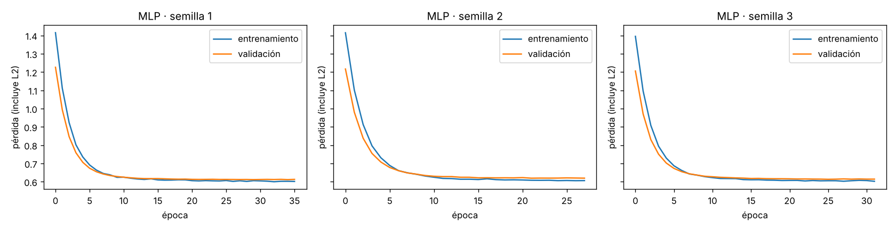

# Informe comparativo · ¿Vale la pena la red? (Sprint 10)

**Equipo 5 Green:** Cristina, Miguel, Fran, Andri y Anzhela · Problema: cancelaciones (`cancelada`) · Datos: 6000 reservas sintéticas de TurisData

## 1. Pregunta y respuesta
Recomendamos **mantener el boosting** porque la red no lo mejora de forma clara en la prueba (diferencia de AUC de +0,007, con un intervalo del 95 % de [−0,005, +0,020] que incluye el 0), tarda unas 37 veces más en entrenar (10,7 s frente a 0,3 s) y es más difícil de explicar.

## 2. Resultados
Resultados en el conjunto de **prueba** (1200 reservas, mirado una sola vez):

| Modelo | AUC | AP | F1 | Exactitud |
|---|---|---|---|---|
| Boosting de árboles | 0,738 | 0,722 | 0,639 | 0,672 |
| MLP (media de 3 semillas) | 0,745 | 0,725 | 0,616 | 0,672 |

AUC de validación del MLP: 0,748 ± 0,001 (3 semillas). Diferencia de AUC (MLP − boosting): +0,007, intervalo del 95 %: [−0,005, +0,020]. La diferencia **no es** mayor que el ruido: veredicto estadístico, **empate**.

El MLP elegido es el de `l2=0.01` (el resto igual que la base: capas 64 y 32, dropout 0,3, tasa 0,001). Se eligió mirando solo la validación entre cuatro variantes cuyo AUC de validación va de 0,744 a 0,748, es decir, todas muy parecidas.

## 3. Curva comentada

Una gráfica por semilla, con la pérdida de entrenamiento y la de validación. Diagnóstico: con `l2=0.01`, la pérdida de validación deja de mejorar entre las épocas 22 y 30 (según la semilla) y el entrenamiento sigue bajando muy poco; la brecha entre validación y entrenamiento es de solo ≈ 0,01. **No hay sobreajuste claro: las dos curvas bajan juntas y la parada temprana (paciencia de 6 épocas, máximo 40) corta a tiempo.**

## 4. Coste
Tiempo de entrenamiento: boosting 0,3 s · MLP 10,7 s por semilla (≈ 37 veces más) · Complejidad: boosting = 200 iteraciones de árboles de profundidad ≤ 4; MLP = 4.417 pesos y varios ajustes que vigilar (neuronas, dropout, L2, tasa, parada) · Explicabilidad: el boosting se explica con la importancia de variables; el MLP es una caja negra de pesos, mucho más difícil de justificar a un directivo o a un cliente.

En resumen: la red cuesta más de entrenar, de mantener y de explicar, y a cambio no demuestra mejorar. Un hotel con un solo técnico no gana nada con cambiarla.

## 5. Riesgos de IA responsable
1. **Riesgo:** los datos son sintéticos (inventados), así que el resultado puede no valer con reservas reales. **Medida:** repetir la comparación con datos reales del hotel antes de cambiar nada.
2. **Riesgo:** el modelo no rinde igual con todos los países. En validación, el AUC del MLP va de 0,64 (país «otros») y 0,70 (Alemania) a 0,90 (Países Bajos), con grupos de entre 53 y 250 reservas, así que las cifras por grupo son poco fiables. **Medida:** medir el AUC por país y canal con más datos y no automatizar decisiones para los grupos donde rinde peor.
3. **Riesgo:** el umbral y el coste de equivocarse. Con umbral 0,5 en validación, el MLP deja sin detectar 183 cancelaciones y da 117 falsas alarmas; un umbral de 0,3 detecta casi todas (52 sin detectar) pero sube las falsas alarmas a 303, y cada falsa alarma puede provocar *overbooking*. **Medida:** fijar el umbral con el coste real de un *overbooking* frente a una habitación vacía, no con el 0,5 por defecto.

## 6. Límites y siguiente paso
No sabemos si el resultado se mantiene con datos reales: solo hay 6000 reservas sintéticas y una única partición, y la prueba (1200 reservas) da un intervalo bastante ancho. Un empate con estos datos no demuestra que la red nunca pueda ganar: la recomendación cambiaría con muchos más datos, o con datos de otro tipo (texto de comentarios, imágenes). Además, las cifras pueden variar en la tercera cifra decimal entre ejecuciones y ordenadores.

Siguiente paso: pedir datos reales, repetir la comparación con el mismo procedimiento, elegir el umbral con el coste del *overbooking* y medir el error por país y canal. En la variante de precio por noche (opcional del cuaderno), el boosting gana con claridad (error medio de 6,92 € frente a 11,91 € del MLP), lo que refuerza la recomendación.

## Uso de la IA
Pedimos a la IA que nos generara el cuaderno completo con los cuatro ejercicios resueltos, las variantes del MLP y los borradores de informe, README y autoevaluaciones; comprobamos a mano que el cuaderno se ejecuta de arriba abajo en Google Colab sin errores, que todas las métricas y cifras del informe coinciden exactamente con las salidas del cuaderno y que todos los miembros entendemos el código; cambiamos los textos marcados para personalizarlos según el reparto de tareas del equipo y verificamos la carga del modelo guardado `.keras`.

## Revisión con la rúbrica

Revisado por: Cristina · Fecha: 17/11/2026

| Criterio | Nivel (1–4) | Prueba: una frase de lo que has comprobado |
|---|---|---|
| Corrección técnica | 4 | Pasan todos los `assert` de los 4 ejercicios, partición única sin fuga de datos y prueba usada solo en la sección 6. |
| Reproducibilidad | 4 | Reiniciado y ejecutado todo en Colab desde cero obteniendo exactamente las mismas cifras del informe y el `.keras` recargado. |
| Análisis y comunicación al cliente | 3 | Responde claro al cliente con media ± desviación, intervalo bootstrap, tiempos y límites de los datos sintéticos. |
| IA responsable | 3 | Incluye 3 riesgos concretos con medidas y tablas en validación desglosando AUC por país/canal y costes por umbral. |

Lo primero que mejoraríamos: incorporar una matriz de costes reales de *overbooking* frente a habitación vacía para calcular el umbral óptimo exacto.